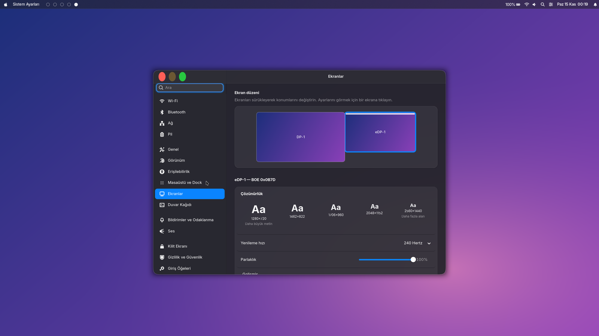
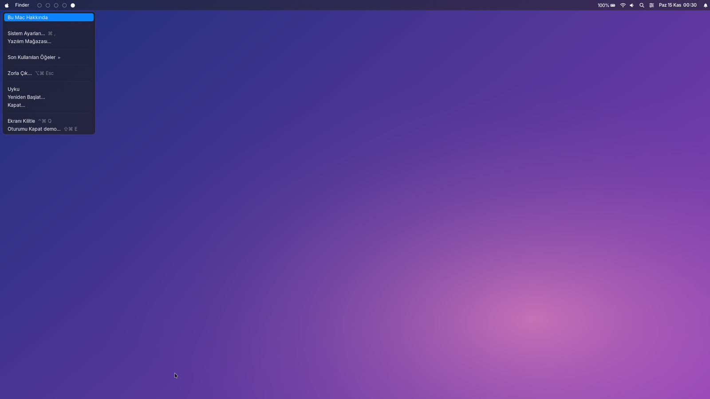
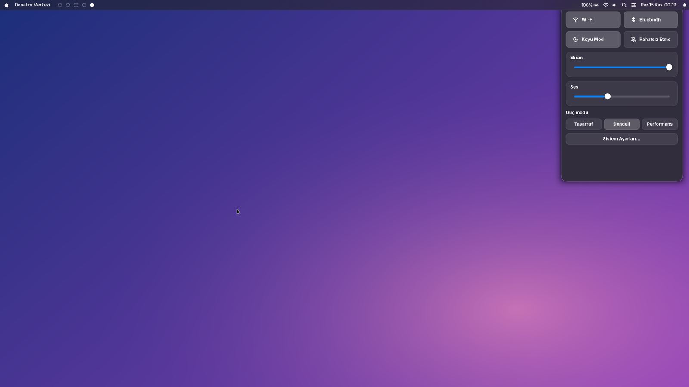
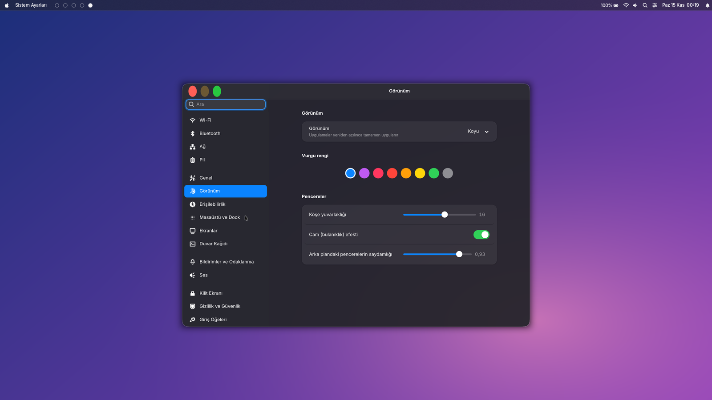

# Tahoe Hyprland

**A macOS Tahoe–style desktop for Hyprland, installable with one command.**
**Hyprland için tek komutla kurulan macOS Tahoe görünümlü masaüstü.**

No third-party themes: the GTK theme, the System Settings app, the Apple menu, the Control Center, the lock screen and everything else are written from scratch in this repo. · Üçüncü parti tema yok: GTK teması, Sistem Ayarları, Apple menüsü, Denetim Merkezi, kilit ekranı ve geri kalan her şey bu repoda sıfırdan yazıldı.

| System Settings → Displays | Apple menu |
|---|---|
|  |  |
| **Control Center** | **Appearance** |
|  |  |

> Not affiliated with or endorsed by Apple. No Apple assets are used; the wallpaper is generated by code. "macOS" and "Tahoe" are trademarks of Apple Inc.
> Apple ile bağlantısı yoktur; Apple varlıkları kullanılmaz, duvar kağıdı kodla üretilir.

## Install · Kurulum

```bash
bash <(curl -fsSL https://raw.githubusercontent.com/alprde/mhyprland/main/install.sh)
```

or from a clone · ya da klonlayarak:

```bash
git clone https://github.com/alprde/mhyprland && cd mhyprland
./install.sh            # --dry-run to preview · --no-packages · --yes · --uninstall
```

Then **log out and pick the `Hyprland` session** on your login screen. Your displays are detected on the first start.
Sonra **oturumu kapatıp giriş ekranında `Hyprland` oturumunu seçin.** Ekranlar ilk açılışta otomatik algılanır.

The installer backs up your existing `hypr`, `waybar`, `rofi`, `swaync`, `nwg-dock-hyprland`, `gtk-3.0`, `gtk-4.0` configs to `~/.config-backup-tahoe-<date>/`. `./install.sh --uninstall` removes Tahoe and restores the last backup.

### Requirements · Gereksinimler

- An **Arch-based** distro (`pacman`) — developed and tested on CachyOS. Other distros are not supported yet.
- **Hyprland ≥ 0.55** (this project ships the Lua config format).
- Everything else is installed from the official repos; no AUR packages needed.

## What you get · Neler var

- **Menu bar** (waybar): Apple logo, active app name (click → app menu), workspaces, tray, battery, Wi-Fi, volume, Spotlight, Control Center, clock, notifications. Glass blur, rounded windows, macOS-style animations.
- **Apple menu**: About This Mac, System Settings, Software Store, Recent Items, Force Quit, Sleep, Restart, Shut Down, Lock Screen, Log Out.
- **System Settings** (`tahoe-settings`, GTK4/libadwaita), 21 panes: Wi-Fi, Bluetooth, Network, Battery, General (about/storage/updates), Appearance (light/dark + 8 accent colors), Accessibility, Desktop & Dock, Displays (draggable layout, scaled resolutions, refresh rate, rotation, mirroring, VRR, night light), Wallpaper, Notifications & Focus, Sound, Lock Screen, Privacy & Security, Login Items, Users, Keyboard, Mouse & Trackpad, Printers, Date & Time, Language & Region.
- **Control Center** (a popup under the menu bar, opens instantly via a small background daemon; closes on outside click or `Esc`): Wi-Fi, Bluetooth, dark mode, Do Not Disturb, brightness, volume, power profile, now playing.
- **Tray helper**: left-clicking tray apps that ignore it (e.g. Claude Desktop) now opens them (`tahoe-tray-assist`).
- **Spotlight** (rofi), **Dock** (nwg-dock-hyprland), **notifications** (swaync), **lock screen** (hyprlock), **idle/lock/suspend** (hypridle), generated **GTK3/GTK4 theme** "Tahoe".

### Shortcuts · Kısayollar (`⌘` = Super)

| Keys | Action |
|---|---|
| `⌘ Enter` | Terminal |
| `⌘ Space` / `⌘ D` | Spotlight |
| `⌘ Tab` | Window switcher |
| `⌘ ,` | System Settings |
| `⌘ Q` | Close window |
| `⌘ F` / `⌘ V` | Fullscreen / floating |
| `⌘ M` / `⌘ ⇧ M` | Minimize window / show minimized windows |
| `⌘ 1…0`, `⌘ ⇧ 1…0` | Switch workspace / move window |
| `⌘ ⇧ 3`, `⌘ ⇧ 4` | Screenshot (screen / region) to clipboard |
| `⌘ ⌃ Q` | Lock screen |
| `⌥ ⌘ Esc` | Force Quit |
| `⌘ ⇧ E` | Log out |

## How it works · Nasıl çalışır

All user choices live in `~/.config/tahoe/settings.json`. `tahoe-settings --apply` regenerates everything from it: `~/.config/hypr/tahoe.lua` (monitors, input, look), the GTK themes, waybar/dock/rofi/swaync styles, `hypridle.conf`. **Do not edit generated files by hand** — change settings in the app instead.
See [NOTES.md](NOTES.md) for architecture, design decisions and the pitfalls we hit.

```
bin/       tahoe-settings (app + Control Center), tahoe-apple-menu, tahoe-app-menu, tahoe-dock, …
config/    hyprland.lua, waybar, rofi, gtk settings, hyprlock/hyprpaper templates
share/     base.css  — the GTK theme source (dark; light is derived)
themes/    Tahoe GTK theme metadata
install.sh one-command installer / uninstaller
```

## Hybrid laptops (Intel/AMD + NVIDIA) · Hibrit dizüstüler

Hyprland normally picks the right GPU. If the desktop starts on the wrong GPU, pin the order in `~/.config/hypr/hyprland.lua`:

```lua
hl.env("AQ_DRM_DEVICES", "/dev/dri/card1:/dev/dri/card0")  -- iGPU first
```

(use `ls -l /dev/dri/by-path/` to see which card is which; card numbers can change between boots).

## Known limitations · Bilinen sınırlar

- **UI language is Turkish only** for now (strings are in `bin/tahoe-settings` and the menu scripts). Translations are very welcome — see Contributing.
- **No per-app menus** ("File, Edit, View…"): Wayland apps don't export them. The app-name menu offers hide/minimize/fullscreen/quit instead.
- **No per-window titlebar traffic lights** for arbitrary apps (would need the `hyprbars` plugin). Our own apps and GTK client-side-decorated windows have them.
- **Icons**: uses `breeze-dark`/Adwaita; no custom icon set. **Qt apps** are not themed (install `kvantum`/`qt6ct` and pick a dark theme).
- **Light mode** applies to GTK apps, bar, dock and menus, but is less polished than dark.
- Tested on **CachyOS + Hyprland 0.57** with one laptop and one external monitor only. Please open issues for anything else.

## Contributing · Katkı

Issues and PRs welcome. Good first contributions: translations (an i18n layer), more distros in `install.sh`, a light-mode polish pass, Qt theming, more Settings panes. Keep the "no third-party theme" rule: everything here should be reproducible from the code in this repo.

## License

MIT — see [LICENSE](LICENSE).
